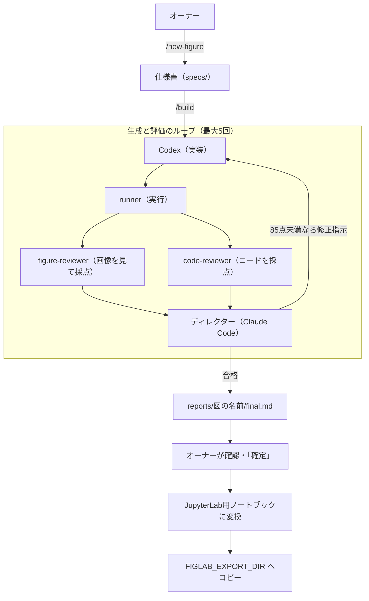

# research-figure-lab

研究用の図を描く Python コードを、**OpenAI Codex が書き → Claude Code のサブエージェントが実行・採点・修正指示 → 合格まで自動で繰り返す** マルチエージェント構成のテンプレートです。
GAN（生成役と識別役を競わせる）の考え方を、コード生成とレビューに応用しています。

A multi-agent template where **Codex writes figure-plotting code and Claude Code sub-agents run, score, and send fixes back until it passes**.



## 構成
| ファイル | 役割 |
|---|---|
| `CLAUDE.md` | ディレクター（Claude Code）の方針・合格基準・確定時の手順 |
| `AGENTS.md` | 実装担当（Codex）のルール。データ改変の禁止、JupyterLab 向けの入出力の形 |
| `.claude/agents/` | 審査員3人（runner / figure-reviewer / code-reviewer） |
| `.codex/agents/` | 同じ審査員の Codex 用定義 |
| `.claude/commands/` | `/new-figure`（仕様書づくり）と `/build`（自動ループ） |
| `specs/` | 図の仕様書。`TEMPLATE.md` から作る |
| `reference/code/` | オーナーの過去コード（スタイルのお手本。数値はサンプル値に置換済み） |
| `data/sample/` | 動作確認用の合成データ |

## 必要なもの
- Claude Code（Claude の有料プラン）
- Codex CLI（ChatGPT の有料プラン）
- Python 3.12、Git

## セットアップ
```bash
git clone <このリポジトリ>
cd research-figure-lab
python -m pip install -r requirements.txt
cp .env.example .env   # 値を各自の環境に合わせて書き換える
```
環境変数は、OS の環境変数として設定するか、`.claude/settings.local.json`（Git 管理外）の `env` に書くと Claude Code から参照できます。

Codex は事前に一度 `codex` を起動し、ログインとサンドボックス設定を済ませてください。

## 使い方
```text
claude
> /build sample_growth          # まずサンプルで動作確認
> /new-figure fig1_my_figure    # 自分の図の仕様書を作る
> /build fig1_my_figure         # 合格まで自動で回す
> 確定                           # ノートブック化・コピー・コミット
```

## 研究不正を防ぐしくみ
評価ループでは「合格するために元データを加工する」リスクがあるため、
1. Codex には `data/` と `specs/` の変更を禁止（AGENTS.md）
2. code-reviewer がデータの誠実さを最重点で採点
3. ディレクターが毎ラウンド、データのハッシュを確認
4. Claude Code の設定で `data/` の編集を拒否（`.claude/settings.json`）

## 注意
- `data/`（サンプル以外）、`reports/`、`output/`、`specs/ref/` は `.gitignore` で公開対象から外しています。
- `.env` や API キーは絶対にコミットしないでください。
